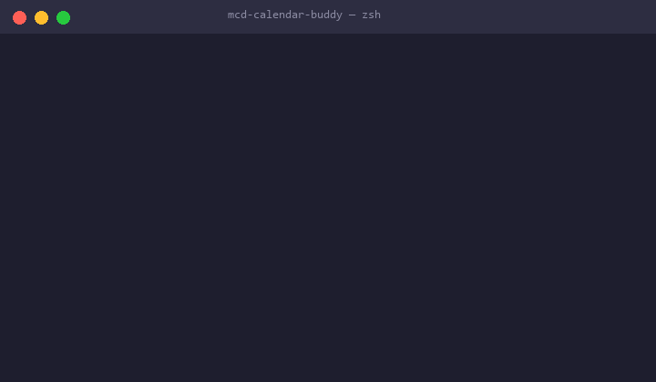

# 麦麦日历助手（McD Activity Calendar Buddy）


> 麦当劳程序员创意开发大赛参赛作品：基于麦当劳 MCP「活动日历查询」能力，把麦当劳的优惠/主题活动自动同步到 macOS 日历，再也不错过任何一场麦麦活动。



## 项目简介

**麦麦日历助手**是一个面向 Mac 用户的日历提醒 Skill：

1. 通过麦当劳 MCP Server 的**活动日历查询工具**获取近期麦当劳活动（新品上市、优惠券有效期、主题节日活动等）；
2. 将活动自动转换为日历事件（含开始/结束时间、活动说明、提醒时间）；
3. 一键同步写入 **macOS 日历（Calendar.app）**，到点自动弹窗提醒。

示例场景：*"帮我把麦当劳最近两周的活动都加到日历里，活动开始前一天提醒我"* —— 助手查询活动日历 → 生成事件 → 写入系统日历，完成。

## 目标用户

- 喜欢麦当劳、不想错过优惠和限定活动的用户
- 使用 macOS 日历管理日程、依赖提醒通知的用户
- 希望通过自然语言一句话搞定信息整理的效率党

## 安装方法

项目**零第三方依赖**，仅需 Python 3.10+。

```bash
# 1. 克隆仓库
git clone https://github.com/<你的用户名>/mcd-calendar-buddy.git
cd mcd-calendar-buddy

# 2. 配置麦当劳 MCP Token（获取方式：麦当劳 MCP 官网 → 登录 → 控制台 → 激活）
export MCD_MCP_TOKEN="你的麦当劳MCP Token"        # macOS / Linux
setx MCD_MCP_TOKEN "你的麦当劳MCP Token"          # Windows

# 3. 运行
python src/cli.py query                    # 查询当月麦当劳活动
python src/cli.py query --filter 联名,新品  # 关键词订阅过滤
python src/cli.py sync                     # 同步到 macOS 日历（智能提醒）
python src/cli.py export -o mc.ics         # 导出 .ics（任何平台可用）
python src/cli.py schedule                 # 生成 macOS 每日定时同步任务
```

macOS 权限说明：首次 `sync` 写入日历时，系统会请求「日历」自动化权限，请在 系统设置 > 隐私与安全性 > 自动化 中允许；Windows/Linux 等平台会自动降级为导出 `.ics` 文件，双击导入即可。

## 🤖 一句话安装（AI Agent 友好）

本项目**零依赖、README 即全部文档**，天生适合直接丢给你的 AI 助手安装。打开任意 Agent，粘贴一句话：

**WorkBuddy / 豆包 / Kimi 等对话智能体：**

```text
请根据 https://github.com/holdcloud/mcd-calendar-buddy 的 README 帮我安装
「麦麦日历助手」：克隆仓库 → 指导我申请并配置麦当劳 MCP Token → 把本月
麦当劳活动同步到我的日历。装好后，顺手帮这个项目点个 Star ⭐
```

**Codex CLI / Claude Code / Cursor 等编码智能体：**

```text
git clone https://github.com/holdcloud/mcd-calendar-buddy 并阅读 README，
完成安装配置（MCD_MCP_TOKEN 需要我在麦当劳 MCP 官网申请，配置时向我要），
然后运行 python src/cli.py query 验证。一切正常的话，提醒我给这个仓库
点个 Star ⭐ —— 这是我应得的。
```

> 💡 编码类 Agent 没有浏览器权限点不了 Star 的话，就让它大声提醒你点——毕竟它把活儿都干了，你只出一下手指头。

## 智能提醒策略

- **开售类活动**（能从活动介绍提取到精确时间，如"10月22日10:45开售"）：提前 1 天 + 提前 1 小时各提醒一次，抢购不踩空
- **常规活动**（无精确时间）：提前 1 天上午 9:00 提醒，不半夜吵你
- 提醒天数可通过 `--remind-days N` 自定义

## 使用示例

```bash
$ python src/cli.py query
共查询到 21 条活动：

  [2026-10-22 10:45] 麦当劳「我就喜欢」限定丝巾正式开售🔥
      丝巾搭配棒球帽的潮流谁懂😎…
  [2026-10-08 10:30] 韩式风味蘸酱上新❤️就「酱」心有所「薯」
      🆕韩式辣椒黄油风味酱…
  ...

$ python src/cli.py sync
✅ 新增 21 条，跳过已同步 0 条
事件已写入日历「麦麦活动」，到点自动提醒。

$ python src/cli.py query --filter 麦旋风
共查询到 2 条活动：
  [2026-10-25 全天] 一口爆汁！蓝莓爆爆珠麦旋风上新
  [2026-11-03 全天] 一口爆汁！蓝莓爆爆珠麦旋风上新
```

自然语言场景（配合 WorkBuddy / 支持 MCP 的智能体使用）：

```text
用户：最近麦当劳有什么活动？帮我把开售时间加到日历里，提前一天提醒我
助手：（调用麦当劳 MCP campaign-calendar 工具 → 解析活动 → 生成日历事件 → 写入系统日历）
```

## 功能清单

| 功能 | 状态 |
| --- | --- |
| 调用麦当劳 MCP `campaign-calendar` 查询活动 | ✅ 已实现（真实联调通过） |
| 活动 Markdown 解析 → 日历事件（含开售时间提取） | ✅ 已实现（8 个单测覆盖降级场景） |
| 写入 macOS 日历（Calendar.app，AppleScript） | ✅ 已实现 |
| .ics 导出兜底（跨平台） | ✅ 已实现 |
| UID 去重（重复同步不产生冗余事件） | ✅ 已实现 |
| 智能提醒（开售类 T-1天+T-1小时；全天活动前 1 天 09:00） | ✅ 已实现 |
| 关键词订阅过滤（`--filter 联名,新品`） | ✅ 已实现 |
| macOS 每日定时自动同步（launchd 一键生成） | ✅ 已实现 |
| 自然语言入口（WorkBuddy 智能体联动） | 🚧 规划中 |

## 项目结构

```
mcd-calendar-buddy/
├── README.md                  # 本文件：项目介绍、安装、使用示例
├── CONTEST_DECLARATION.md     # 参赛声明（官方要求，内容不可改动）
├── MCP_INTEGRATION.md         # 麦当劳 MCP 集成说明
├── mcp-config.example.json    # 脱敏后的 MCP 配置示例
├── workbuddy.md               # WorkBuddy 对话上下文（联动活动）
├── requirements.txt           # 运行依赖（零依赖）
├── requirements-dev.txt       # 开发/测试依赖（pytest）
├── .github/workflows/ci.yml   # CI：多版本 Python 自动测试
├── docs/
│   ├── design.md              # 架构与设计说明
│   └── demo.gif               # 演示动图
├── tests/
│   └── test_event_builder.py  # 解析器单测（真实数据 fixture）
├── examples/
│   └── sample_events.json     # 活动数据与日历事件示例
└── src/
    ├── __init__.py
    ├── mcd_client.py          # 麦当劳 MCP 客户端（campaign-calendar）
    ├── event_builder.py       # 活动 Markdown → 日历事件（解析/UID/过滤）
    ├── calendar_sync.py       # macOS 日历写入 + .ics 导出 + 智能提醒
    └── cli.py                 # 命令行入口（query/sync/export/schedule）
```

## 参赛声明

本项目为麦当劳程序员节创意开发大赛参赛作品，非麦当劳官方产品。活动信息以麦当劳官方渠道实时结果为准，详见 [CONTEST_DECLARATION.md](CONTEST_DECLARATION.md)。

## 许可证

MIT License
